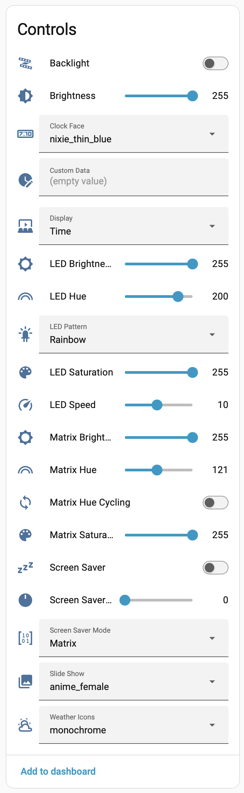
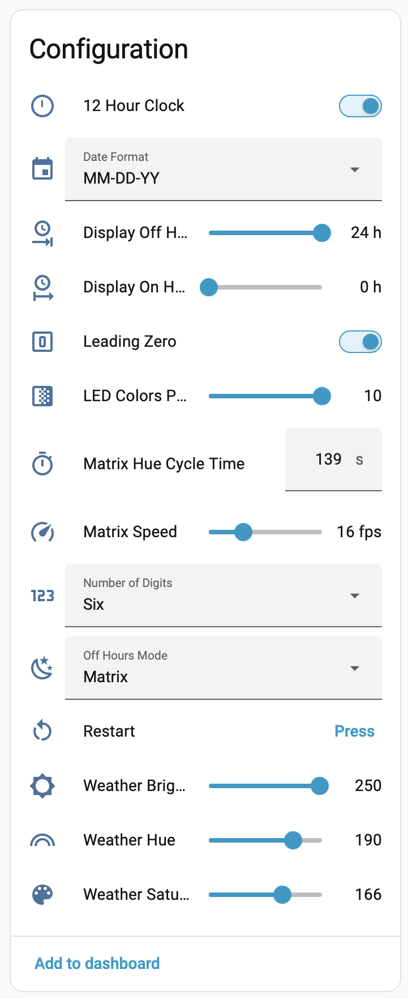

# A Custom Firmware for the EleksTube IPS V1 clock

This is a fork of [judge2005/EleksTubeIPS](https://github.com/judge2005/EleksTubeIPS). Version 2.0.1 is based on upstream 1.9.5. It adds much more Home Assistant control and fixes several crashes and slow pages. Everything else works as described in the [upstream wiki](https://github.com/judge2005/EleksTubeIPS/wiki).

## What's different from upstream

### Home Assistant and MQTT

* **Entities keep working after Home Assistant restarts.** When Home Assistant starts, it asks devices to describe their entities again. Since upstream 1.8.1 the clock's check for that request was inverted, so it answered when Home Assistant shut down and stayed silent when it came back. After a Home Assistant restart, controls such as Backlight and Screen Saver stopped working until the clock was restarted too.
* **36 Home Assistant entities instead of 6.** Almost every setting in the web UI can now be changed from Home Assistant. Everyday controls are listed under Controls, and set-and-forget settings under Configuration.

   

  New entities: Clock Face, Weather Icons and Slide Show selects; LED Pattern, Hue, Saturation, Brightness, Speed and Colors Per LED; Matrix Hue, Saturation, Brightness, Speed, Hue Cycling and Hue Cycle Time; Screen Saver Mode; Off Hours Mode; Display On Hour and Display Off Hour; 12 Hour Clock; Leading Zero; Number of Digits; Date Format; Weather Hue, Saturation and Brightness; Weather Units, Latitude and Longitude; and a Restart button.
* **Upload and delete clock faces, weather icons and slide shows over MQTT** ([upstream issue #85](https://github.com/judge2005/EleksTubeIPS/issues/85)). The Clock Face, Weather Icons and Slide Show selects update when files are added or removed. See [Uploading files over MQTT](#uploading-files-over-mqtt).
* **Settings changed from Home Assistant are saved**, so they survive a restart. Upstream lost changes to Brightness, Display and Screen Saver Delay. Values are kept within the same ranges as the web UI.
* **Your MQTT password and OpenWeatherMap API key are no longer published.** Upstream included the whole configuration, credentials too, in the state it publishes to the broker.
* Only settings that have an entity can be changed over MQTT. Time zone, hostname, Wi-Fi, MQTT settings and the OpenWeatherMap API key can't.
* Discovery no longer stalls the MQTT connection at startup, and matrix hue cycling no longer republishes the clock's whole state every second.

### Stability

* Updated the network library (AsyncTCP) from 1.1.1 to [esp32async 3.5.0](https://github.com/ESP32Async/AsyncTCP). The old version crashed when connections opened and closed quickly, for example under a busy browser or a network scan.
* Fixed a crash when the web UI was sent updates from more than one task at once.
* Fixed a crash when switching the screen saver between Blank and Matrix with hue cycling on.
* Images are checked before they're drawn, so a malformed image can't crash the clock.
* Web uploads are written to a temporary file first, so a failed upload no longer destroys the file it was replacing. The name, file type and free space are checked before anything is written.
* Out-of-range LED and matrix speeds can no longer cause a divide-by-zero crash.

### Speed and size

* The Info page loads in about 10 ms instead of 1.5 s, and the Files page in under 0.1 s instead of 0.5 s.
* The firmware has about 230 KB of flash to spare. Upstream 1.9.5 is 48 bytes short of the limit, so any addition stopped it booting. Most of the room comes from dropping the web server's regular-expression support, which only one URL used. The build now fails if the firmware is too big, instead of producing one that won't boot.
* The weather display is redrawn when the weather, its colors or the brightness change, instead of every 10 seconds.
* Each weather update makes one request fewer, and skips connecting at all if no API key is set.

### Building

* The firmware builds without compiler warnings (upstream printed about 960 lines of them), and the web UI build installs far fewer npm packages.

### Other fixes

* If the archive for the selected clock face, weather icons or slide show is missing, the clock reliably goes back to the previous one.
* Uploading a new version of the clock face, weather icons or slide show in use now shows it straight away.
* A brightness change from Home Assistant now redraws the weather display immediately.
* When the forecast is a day short, that day shows the "unknown" icon instead of an old one from an earlier forecast.

## Installing 2.0.1

This firmware can't update itself over Wi-Fi, so flash it over USB. The easiest way is the [web installer](https://kedube.github.io/EleksTubeIPS/), which works in Chrome or Edge on a computer. To use esptool.py instead, download the files from the [2.0.1 release](https://github.com/kedube/EleksTubeIPS/releases/tag/v2.0.1). The [upstream installation guide](https://github.com/judge2005/EleksTubeIPS/wiki/Installation) covers connecting the clock and backing up its original firmware.

| Clock | Firmware file |
|---|---|
| EleksTube IPS V1, Xunfeng IPS | `firmware-elekstubev1-2.0.1.bin` |
| EleksTube IPS V2 | `firmware-elekstubev2-2.0.1.bin` |
| NovelLife SE | `firmware-novellifese-2.0.1.bin` |
| Si Hai | `firmware-sihai-2.0.1.bin` |
| PCBWay PunkCyber | `firmware-punkcyber-2.0.1.bin` |
| IPSTube (H401/H402) | `firmware-ipstube-2.0.1.bin` |
| IPSTube with hardware dimming | `firmware-ipstube_dim-2.0.1.bin` |

**Upgrading from 2.0.0, or from upstream 1.9.4 or later:** flash only the firmware file. Your settings, Wi-Fi details and uploaded images are kept. In Home Assistant, the existing entities keep their IDs and the new ones appear by themselves.

```
esptool.py --chip esp32 --port <port> write_flash 0x10000 firmware-elekstubev1-2.0.1.bin
```

**New install, or upgrading from upstream before 1.9.4:** flash all five files. The IPSTube clocks use the `8MB` versions of the bootloader, partition table and filesystem image.

```
esptool.py --chip esp32 --port <port> write_flash \
  0x1000 bootloader.bin 0x8000 partitions.bin 0xe000 boot_app0.bin \
  0x10000 firmware-elekstubev1-2.0.1.bin 0x180000 littlefs-2.0.1.bin
```

## Uploading files over MQTT

Topics start with `clock/<id>`, where `<id>` is the name shown as **SSID** on the clock's Info page, for example `A1B2C3elekstubeips`.

| Action | Topic | Payload |
|---|---|---|
| Upload | `clock/<id>/files/upload/<set>/<name>` | The `.tar.gz` file |
| Delete | `clock/<id>/files/delete/<set>/<name>` | Anything, or empty |

`<set>` is `faces`, `weather` or `slides`. `<name>` is the name without `.tar.gz`: up to 25 characters, without `/`, `\` or `"`. Don't publish these with the retain flag, or the clock will repeat the upload or delete every time it reconnects.

The clock reports the result on `clock/<id>/files/status`:

```json
{"action":"upload","set":"slides","name":"solar","status":"ok"}
```

Instead of `ok`, `status` can be `invalid name`, `unknown set`, `unknown action`, `not a .tar.gz file`, `not enough space`, `could not create file`, `write failed`, `rename failed` or `file not found`.

For example, with Mosquitto's command-line client:

```
mosquitto_pub -h <broker> -u <user> -P <password> \
  -t clock/A1B2C3elekstubeips/files/upload/slides/solar -f solar.tar.gz
```

Settings can also be changed without Home Assistant, by publishing to the topic each entity uses, for example `200` to `clock/<id>/set/led_hue`. An entity's **MQTT INFO** in Home Assistant shows its topic.

## Features of This Firmware

This firmware uses the WiFi support that your clock already has to sync the time with the internet and to provide an easy way to configure the clock and change the display:

* It can display the time, the date or a weather forecast.
* It synchronizes the time with NTP so it is very accurate.
* It automatically handles timezone and DST conversions.
* All clock configuration is done using a web interface.
  * Set the timezone information
  * Set the hours the clock is on
  * Switch between a six digit clock showing seconds and a four digit AM/PM display
  * Enable/disable leading zeros
  * Switch the display between time, date and the weather
  * Set the date format
  * Set the backlight effects and colors
  * Upload, delete and select the images used for the clock display
  * Configure the weather forecast
  * Upload, delete and select the icons used for the weather display
* Clock faces and weather icons can be selected using the buttons.
* You can switch between time, date and weather using the buttons.
* It has a screen saver.
* There is also a tool to convert images in to a format that can be displayed on the clock
* It connects to an MQTT broker for Home Assistant control of almost every setting, uploading images, movement and luminance sensors, and a custom display value. The full state of the clock is published too, without passwords or API keys. See [What's different from upstream](#whats-different-from-upstream) and the upstream [User Guide](https://github.com/judge2005/EleksTubeIPS/wiki/User-Guide#mqtthome-assistant).
* There are specific variants for these clocks. Each link opens the web installer with that clock chosen:
  * [EleksTube IPS V1](https://kedube.github.io/EleksTubeIPS/#elekstubev1), and the Xunfeng IPS
  * [EleksTube IPS V2](https://kedube.github.io/EleksTubeIPS/#elekstubev2)
  * [NovelLife SE](https://kedube.github.io/EleksTubeIPS/#novellifese)
  * [Si Hai](https://kedube.github.io/EleksTubeIPS/#sihai)
  * [PCBWay PunkCyber](https://kedube.github.io/EleksTubeIPS/#punkcyber), also called the RGB Glow Tube DIY Clock
  * [IPSTube](https://kedube.github.io/EleksTubeIPS/#ipstube) (H401/H402)
  * [IPSTube with hardware dimming](https://kedube.github.io/EleksTubeIPS/#ipstube_dim)

This image shows the clock running in 4 digit mode with weather forecast


This shows a weather forecast using colored icons:


This shows the digital rain screen saver:


## Documentation

See [the wiki](https://github.com/judge2005/EleksTubeIPS/wiki "wiki") for detailed information on how to build, install and use this firmware.

* [Installation](https://github.com/judge2005/EleksTubeIPS/wiki/Installation) takes you through backing up the original firmware, building the custom firmware and uploading it to the clock
* [Connecting to WiFi](https://github.com/judge2005/EleksTubeIPS/wiki/Connecting-to-WiFi) takes you through getting your clock connected to your router so it can sync the time with NTP and you can configure it using a web browser.
* [User Guide](https://github.com/judge2005/EleksTubeIPS/wiki/User-Guide) shows you how to configure and control your clock.
* [Image Collections](https://github.com/judge2005/EleksTubeIPS/wiki/Image-Collections) tells you how to prepare new clock faces and weather icon sets so that they can be uploaded to the clock and used.
* [Hardware Modification](https://github.com/judge2005/EleksTubeIPS/wiki/Hardware-Modification) details a mod that you might want to make to your clock, but only if you are comfortable wielding a soldering iron.

## Credits

[Original documentation and software from EleksMaker.](https://wiki.eleksmaker.com/doku.php?id=ips)

This code wouldn't exist without the work done by the people on [this reddit discussion](https://www.reddit.com/r/arduino/comments/mq5td9/hacking_the_elekstube_ips_clock_anyone_tried_it/).

Version 2.0.1 of this fork builds on [judge2005's firmware](https://github.com/judge2005/EleksTubeIPS).
